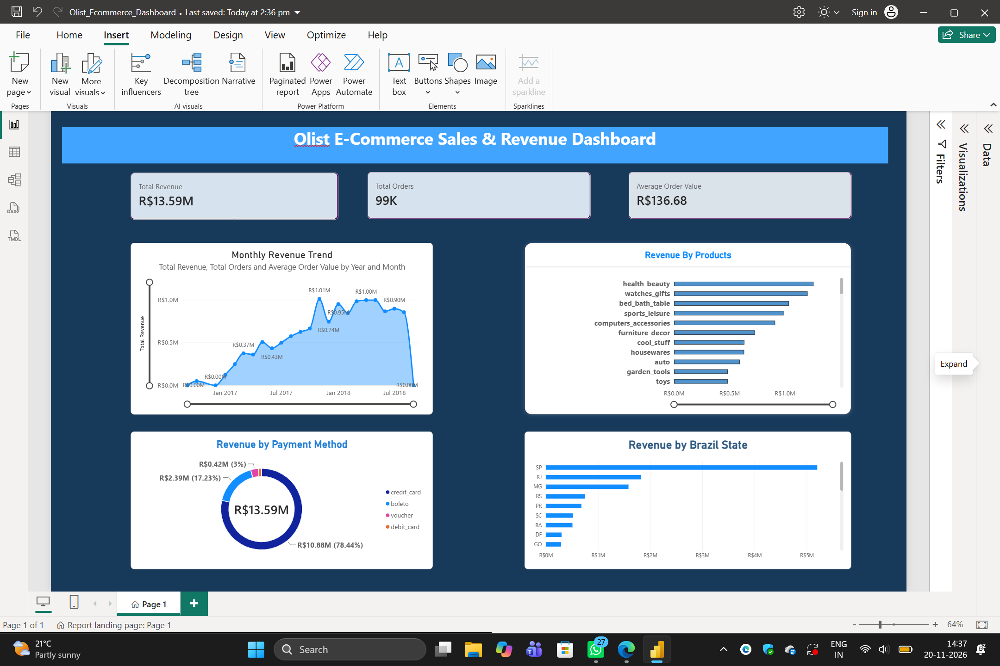
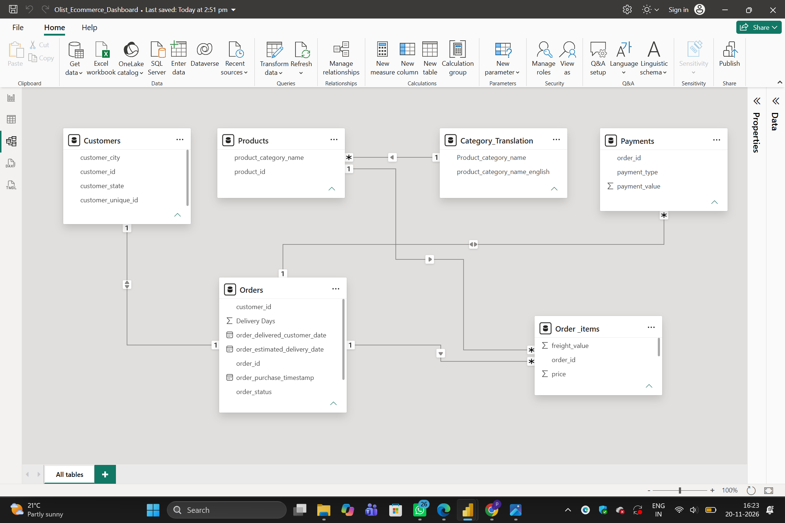

# Olist E-Commerce Sales & Revenue Dashboard (Power BI)

## Project Overview
An interactive executive dashboard built in **Microsoft Power BI** analyzing **99K+ orders** and **R$13.59M** in total revenue from the Brazilian Olist E-Commerce dataset. Designed to track revenue growth, top-performing product categories, customer payment preferences, and geographic demand across Brazil.

## Key Business Insights
* **Total Revenue & Order Volume:** Generated **R$13.59M** across **99K** orders with an **Average Order Value (AOV)** of **R$136.68**.
* **Revenue Growth Trend:** Strong upward revenue trajectory throughout 2017, peaking in late 2017 and stabilizing above **R$0.8M–R$1.0M/month** in 2018.
* **Top Product Categories:** Led by **Health & Beauty**, **Watches & Gifts**, **Bed Bath Table**, and **Sports & Leisure**.
* **Payment Method Breakdown:** **Credit Cards** dominate transactions (**78.44%** / R$10.88M), followed by **Boleto** (**17.23%** / R$2.39M) and **Vouchers** (**3.00%** / R$0.42M).
* **Geographic Concentration:** **São Paulo (SP)** leads all Brazilian states in revenue, followed by **Rio de Janeiro (RJ)** and **Minas Gerais (MG)**.

## Technical Implementation
* **Data Modeling:** Connected 6 relational tables (`Orders`, `Order_Items`, `Payments`, `Customers`, `Products`, `Category_Translation`) using a star-schema structure with bi-directional cross-filtering between `Orders` and `Payments` to accurately attribute multi-payment orders.
* **DAX Measures:** Created dynamic measures for `Total Revenue`, `Total Orders`, and `Average Order Value` formatted in Brazilian Real (`R$`).
* **Interactive Visuals:** Full cross-filtering enabled across all KPIs, time-series trends, category rankings, payment distributions, and state breakdowns.
* ## Dataset Source & Data Cleaning
* **Original Dataset:** [Brazilian E-Commerce Public Dataset by Olist (Kaggle)](https://www.kaggle.com/datasets/olistbr/brazilian-ecommerce)
* **Data Cleaning & Transformation (Power Query):**
  * Merged Portuguese product category names with English translations (`Category_Translation`) for clear business reporting.
  * Standardized date/time columns, currency data types (`R$`), and handled null/unapproved order records.
  * Built a relational star-schema data model connecting 6 tables (`Orders`, `Order_Items`, `Payments`, `Customers`, `Products`, `Category_Translation`) with bi-directional cross-filtering between `Orders` and `Payments`.

## Download Interactive Power BI File
* **[Download Olist_Ecommerce_Dashboard.pbix (34.2 MB)](../../releases/tag/v1.0)**
